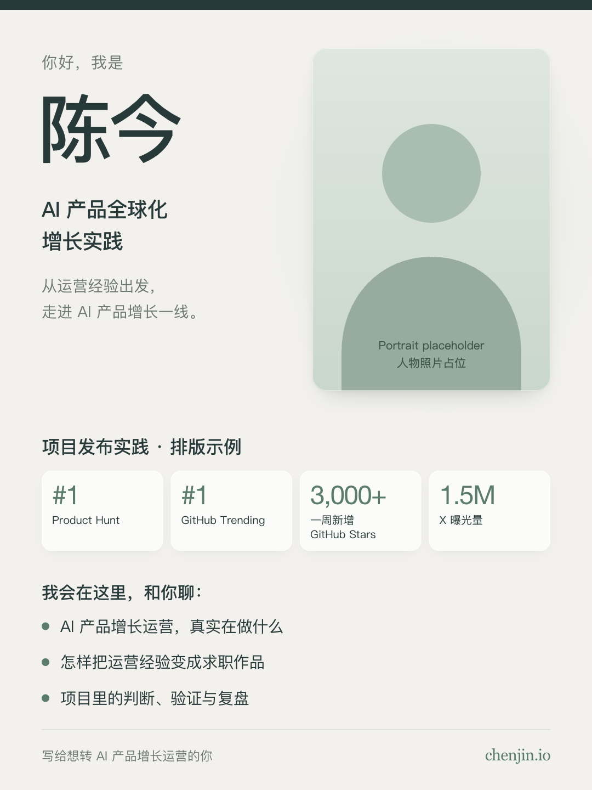

# chenjin.brand

[English](README.md) | [简体中文](README.zh-CN.md)

Chen Jin's personal brand design skills. This collection lives inside `ChenJinCloud/awesome-tools`; add future personal IP design skills under `chenjin.brand/skills/`.

## Skills

| Skill | Use | Version |
| --- | --- | --- |
| [chenjin-brand-xiaohongshu](skills/chenjin-brand-xiaohongshu/SKILL.md) | Code-based 3:4 portrait cards for Xiaohongshu, including a personal introduction template and content pages | 0.1.0 |

The initial visual baseline uses warm moon-white paper, dark teal text, and muted jade accents. Rounded achievement cards, soft shadows, and coordinated bullet points support clear reading. The baseline was refined through the personal introduction card on 2026-10-15.

## Use

Copy or link the individual skill folder into your agent's skill directory. The package includes its instructions, templates, examples, and a Python renderer. Installation example for Codex, from the repository root:

```bash
mkdir -p ~/.codex/skills
ln -s "$PWD/chenjin.brand/skills/chenjin-brand-xiaohongshu" ~/.codex/skills/chenjin-brand-xiaohongshu
```

Use a free target path; keep an existing installation intact. Invoke `$chenjin-brand-xiaohongshu` with the content and any portrait you want to use.

## Preview



The public example uses an illustrated placeholder. Its numbers demonstrate the layout and are not a performance claim. Supply your own current copy and authorized portrait for actual output.

The renderer also supports content pages. See [the input schema](skills/chenjin-brand-xiaohongshu/references/input-schema.md) and the [content example](skills/chenjin-brand-xiaohongshu/examples/content.zh-CN.json).

## Adding skills

Keep each package self-contained under `skills/<skill-name>/`. Add it to this index and provide English and Simplified Chinese documentation, following the parent repository's convention. Fonts, photographs, and third-party illustrations retain their own rights; the templates do not bundle reference-site assets.
